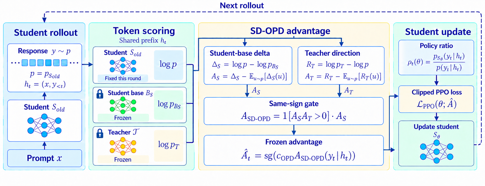

<div align="center">

# Building on What the Student Has Learned: Teacher-Guided On-Policy Distillation

 [](https://github.com/fangbozhen/sd-opd) [](https://github.com/fangbozhen/sd-opd)

</div>

## Overview

**Student-Delta On-Policy Distillation (SD-OPD)** builds on the student's own acquired behavior to improve reasoning under teacher guidance. Standard OPD scales token-level updates by teacher–student log-probability differences, which can emphasize differences in wording and formatting. SD-OPD instead uses the student's changes relative to its frozen pretrained base as the source of update strength:

- **Student-derived coefficients:** centered student–base log-probability differences determine the update magnitude and direction.
- **Teacher-guided selection:** a coefficient is retained only when its sign agrees with centered teacher–student feedback.
- **Evolving supervision:** the student signal is refreshed each training round, while the teacher and base remain fixed.



The study evaluates Qwen3-1.7B, Qwen3-4B, and Qwen3-8B students on six mathematics benchmarks. This repository builds on [slime](https://github.com/THUDM/slime) for training and evaluation; training launchers cover SD-OPD and the OPD and ExOPD baselines.

## Getting Started

Run all commands from the repository root.

### 1. Environment Setup

Follow the [slime environment setup guide](slime/docs/en/get_started/quick_start.md), using the bundled `slime/` checkout. If Megatron-LM is installed outside this repository, set `MEGATRON_ROOT` to its installation directory.

### 2. Models and Data

Download the teacher and student for your chosen training setting into the local `models/` directory, keeping their original model names as subdirectory names. For example, for Qwen3-4B-Instruct-2507 → Qwen3-1.7B:

```bash
hf download Qwen/Qwen3-1.7B --local-dir models/Qwen3-1.7B
hf download Qwen/Qwen3-4B-Instruct-2507 --local-dir models/Qwen3-4B-Instruct-2507
```

The training settings below use the same layout: `models/<model-name>/`. Each model directory should contain its Hugging Face weights, configuration, and tokenizer files.

Download and prepare the data with:

```bash
bash download_data.sh
```

This downloads DAPO-Math-17k for training and six evaluation datasets: AIME 2024, AIME 2025, AIME 2026, HMMT February 2025, AMC 2023, and MATH-500. Raw datasets are saved under `data/`, and evaluation files are prepared under `data/eval/`.

### 3. Training

We provide training scripts for five teacher–student settings in each method directory:

- **SD-OPD:** [train/sd_opd/](train/sd_opd/)
- **OPD:** [train/opd/](train/opd/)
- **ExOPD:** [train/exopd/](train/exopd/)

For example, train Qwen3-1.7B with the Qwen3-4B-Instruct-2507 teacher using SD-OPD:

```bash
CUDA_VISIBLE_DEVICES=0,1,2,3 \
STUDENT_BASE_MODEL=models/Qwen3-1.7B-Base \
bash train/sd_opd/run-qwen3-4B-Instruct-2507-to-qwen3-1.7B-nonthinking-sd-opd.sh
```

### 4. Evaluation

Evaluate a downloaded Qwen3 model:

```bash
CUDA_VISIBLE_DEVICES=0 bash eval/eval_qwen3.sh qwen3-1.7b
```

The script also accepts `qwen3-4b`, `qwen3-8b`, `qwen3-4b-instruct-2507`, and `qwen3-30b-a3b-instruct-2507`. These default to 2, 2, 2, and 8 GPUs per engine, respectively; select a matching number of GPUs with `CUDA_VISIBLE_DEVICES`.

To evaluate the original MiMo teacher:

```bash
CUDA_VISIBLE_DEVICES=0,1 bash eval/eval_mimo_7b_rl_0530.sh
```

To evaluate a trained student, set the matching base model, checkpoint directory, and saved step:

```bash
BASE_MODEL=models/Qwen3-1.7B \
CHECKPOINT_PATH=checkpoints/qwen3-1.7b-opd \
CHECKPOINT_STEP=119 \
CUDA_VISIBLE_DEVICES=0 \
bash eval/eval_checkpoint.sh qwen3-1.7b
```

This example converts `iter_0000119` to Hugging Face format and evaluates it. Change `CHECKPOINT_STEP` to select another saved checkpoint. All evaluations use [eval/math_multi_task.yaml](eval/math_multi_task.yaml), with results saved under `eval/results/`.

## Acknowledgments

Our implementation builds on [slime](https://github.com/THUDM/slime), [SGLang](https://github.com/sgl-project/sglang), and [Megatron-LM](https://github.com/NVIDIA/Megatron-LM). We thank their contributors, as well as the Qwen and MiMo teams and the dataset authors, for their open-source work.

## Citation
